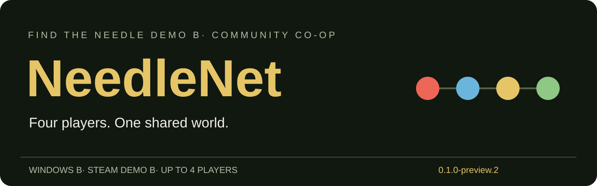

# NeedleNet — ищите иголку вместе

Неофициальный кооператив для **Find The Needle Demo**: один хост и до трёх друзей в общем мире.

**Версия .5 · Windows · Steam Demo, build 25963876 · Предварительная сборка**

## Что внутри

- Сессия и приглашения друзей через интерфейс Steam.
- Отдельные кнопки «Новая игра» и «Загрузить игру» в лобби.
- Общие мир, деньги и прогресс. Мир сохраняет хост.
- Чат с историей и цветами участников: кнопка «Чат» или **Y**.
- Вход в панель сессии из главного меню, меню паузы и по **F2**.

Всем участникам нужны своя игра и одинаковая версия мода. Основа также включает дополнительные машины, улучшения и изменения баланса.

## Скачать и установить

В разделе [**Releases**](https://github.com/GlebTikhiy/NeedleNet/releases/tag/v0.19.6.5-preview) скачайте **NeedleNet-0.19.6.5-Windows-preview.zip** и распакуйте его. Автоматический архив GitHub «Source code» предназначен для разработки; игрокам нужен ZIP с указанным названием.

1. Закройте игру и сделайте резервную копию сохранений.
2. Откройте **Install.cmd** двойным щелчком. Установщик найдёт игру в библиотеках Steam; если не получится, попросит путь к папке с `FindTheNeedle.exe`.
3. Запустите игру через Steam. Выберите «Сетевая игра» → создайте сессию → пригласите друзей → нажмите «Новая игра» или «Загрузить игру».

Предыдущая версия мода и конфигурация сохраняются в `NeedleNet-backups` рядом с игрой. [Ручная установка и откат](docs/INSTALL.md).

## Перед совместной игрой или записью

Это **preview**, а не обещание безошибочного прохождения. Проверены четыре локальных клиента, синхронизация, чат, сохранение/загрузка и сеть с потерями. Реальное приглашение Steam между разными компьютерами, длительное прохождение и восстановление после аварии хоста ещё не проверены. Сглаживание модели требует дополнительной визуальной проверки в живой игре.

[Короткая памятка для стримеров и авторов видео](docs/CREATORS.md). Подробный отчёт о проверках находится в исходном репозитории: `docs/TEST-RESULTS.md`.

## Авторы

NeedleNet развивает [форк Sucukdeluxe / xRangerDE](https://github.com/Sucukdeluxe/FindTheNeedle-Coop-Mod), основанный на моде [AleDev11](https://github.com/AleDev11/FindTheNeedle-Coop-Mod). Код распространяется по MIT, модель игрока Quaternius — CC0. Изменения NeedleNet выполнены с помощью ИИ. Проект не связан с разработчиком игры. [Полное авторство](NOTICE.md).
